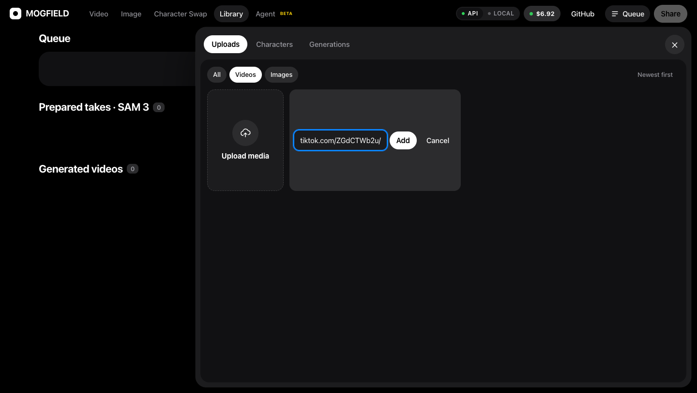
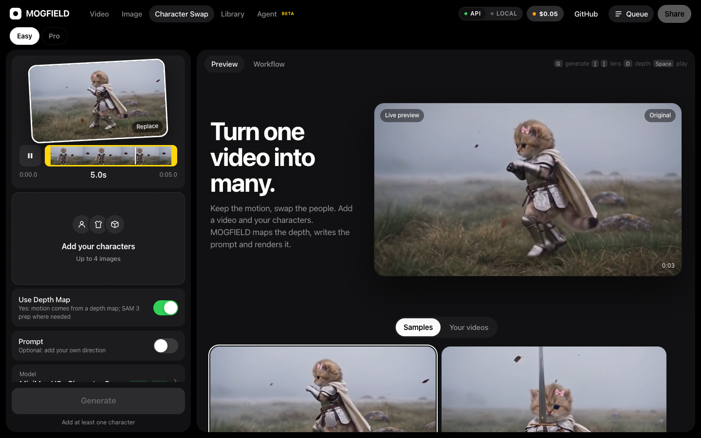
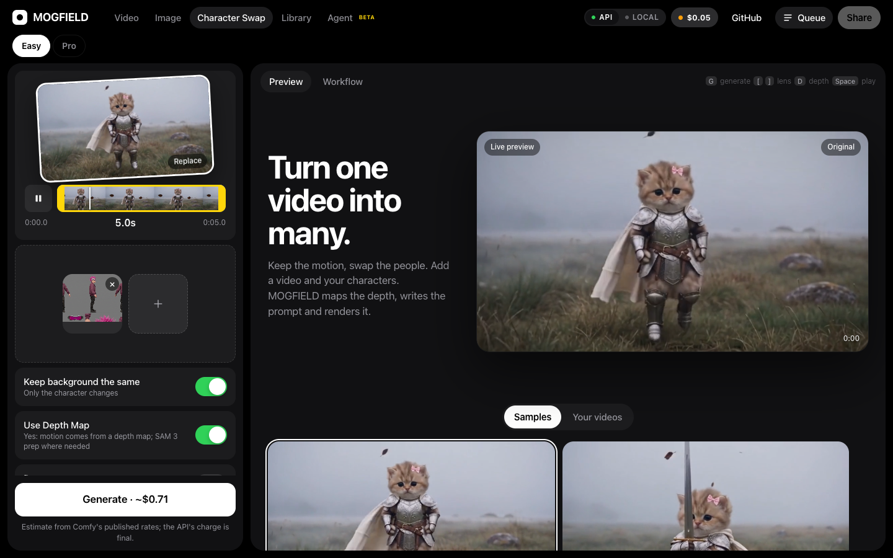
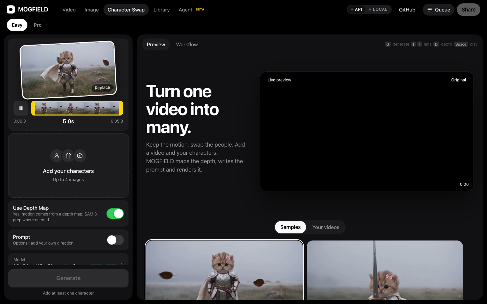
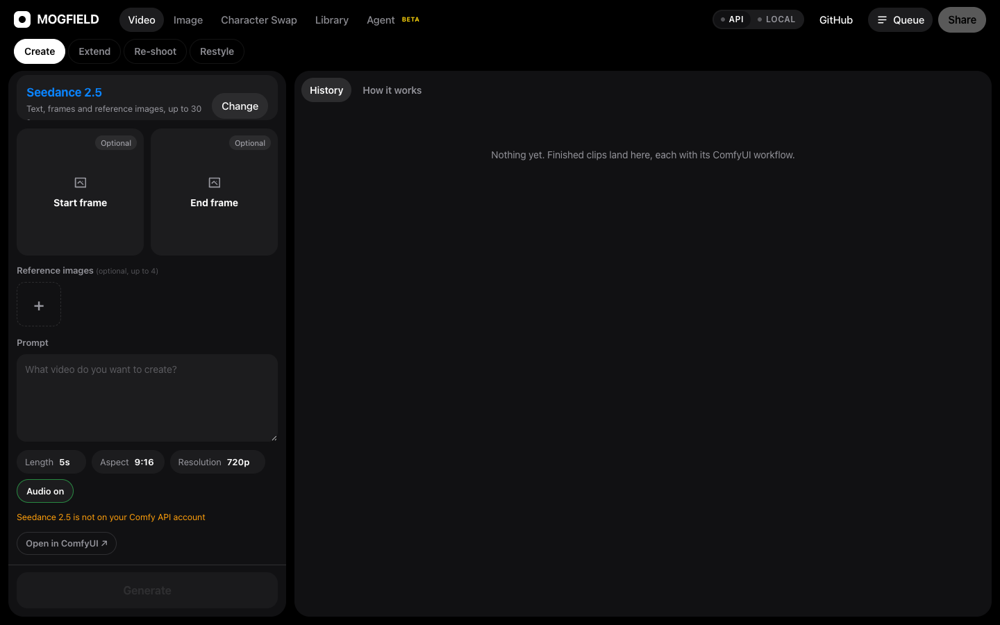
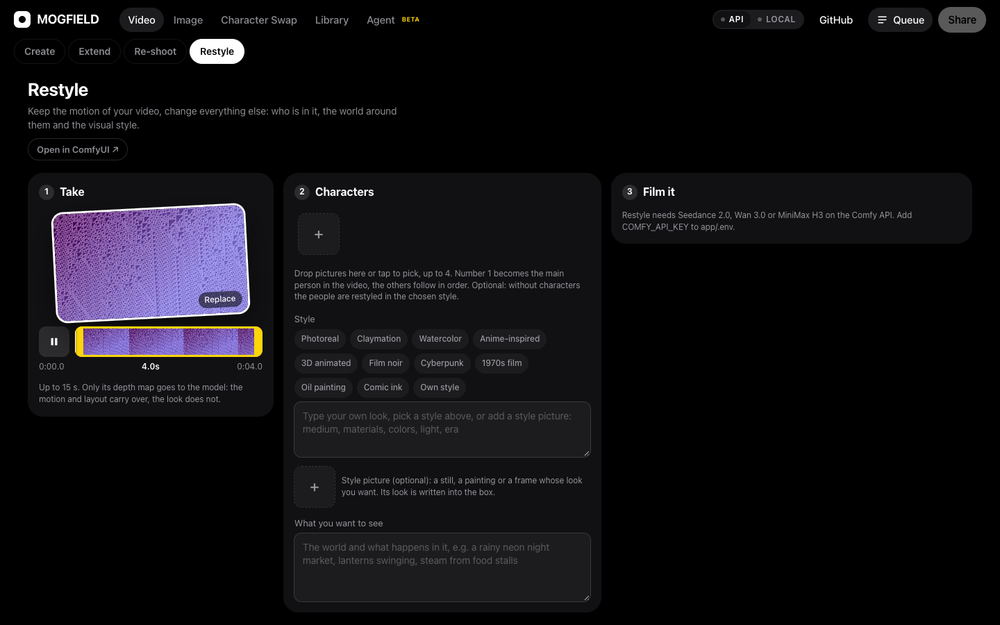
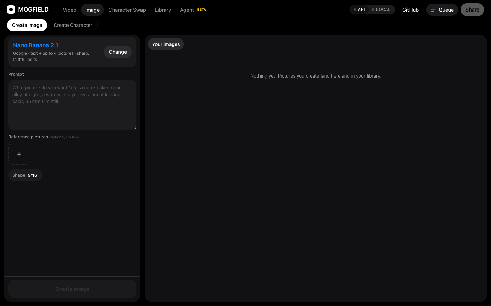

> MOGFIELD is my submission for the ComfyUI challenge: an open-source take on a simple,
> all-in-one AI video studio, built on ComfyUI workflows and the Comfy API.
>
> Enjoy! - Trenchplanet

# MOGFIELD

**Making AI video and images as easy as it gets, for anyone.**

MOGFIELD is an open-source studio that puts the best AI video and image models
behind one simple screen. Add a video or a few pictures, pick a look, press
Generate. The ComfyUI workflow behind every tool is already built and wired for
you, so there's nothing to set up before you can make something.

One switch decides where it runs:

- **API:** paste a Comfy API key and you're generating in a minute, with nothing
  to install. Your jobs run on Comfy Cloud.
- **LOCAL:** point MOGFIELD at your own ComfyUI and everything runs on your own
  GPU, with your own models.

Under the hood, every tool is a ready-made ComfyUI workflow (plain JSON in
[`workflows/`](workflows/)), mapped to its category: Video, Image, Character
Swap, Restyle and so on. Start simple, and whenever you want more control, open
the exact workflow for that tool in ComfyUI and change it.

It is a Vite + React web app with a small Hono server, using
[`@comfyorg/sdk`](https://www.npmjs.com/package/@comfyorg/sdk). The browser
never talks to ComfyUI and never sees your key: the server binds your take and
settings to the workflow, submits it, and streams progress back.

<p align="center">
  
</p>

<p align="center"><sub>Generated with MOGFIELD. <a href="docs/media/demo.mp4">Watch the MP4</a>.</sub></p>

## Paste a link, get the video

No video file? **Paste a TikTok, Instagram or X link.** MOGFIELD downloads the
video for you and opens it with trim controls, so you pick the part you want
(up to 15 s) and carry on. No separate downloader, no file juggling.

1. **Paste the link.** Open *Library → Uploads & characters → Paste link*, or use
   *Paste link* on Character Swap when no video is loaded. Drop in the link and
   press **Add**.

   

2. **Trim it.** The clip is downloaded and opens with a trim bar. Drag the
   yellow handles to choose the moment you want.

   

3. **Add a character, pick a model, press Generate.** The cost shows on the
   button before you spend anything.

   

<p align="center">
  
  
</p>

<p align="center"><sub>Left: a pasted take with a swapped character (Wan 3.0, 480p). Right: a text-to-video clip (MiniMax H3, 4:3). <a href="docs/media/knight.mp4">Watch the MP4</a>.</sub></p>

Links are downloaded with [`yt-dlp`](https://github.com/yt-dlp/yt-dlp) (`brew install yt-dlp`).
Instagram usually needs a logged-in session: see `BACKLOT_YTDLP_COOKIES_FROM_BROWSER`
in [`app/.env.example`](app/.env.example). Only use videos you have the right to use.

## Quick start

```bash
git clone https://github.com/Trenchplanet/mogfield.git
cd mogfield/app
npm install
cp .env.example .env     # paste your Comfy API key after COMFY_API_KEY=
npm run build && npm start
```

Open http://localhost:8787. With a key the header shows **API** and your
remaining Comfy credits; without one the app runs its ffmpeg preview engine so
you can try the whole interface for free.

## Screenshots

| Character Swap | Video |
| --- | --- |
|  |  |

| Restyle | Image |
| --- | --- |
|  |  |

## What you can do

The top bar has five places. Each has its own options in the bar below it.

### Video

- **Create**: a prompt, optional start and end frames, up to four reference
  pictures. Pick a model tuned for MOGFIELD (Seedance 2.5 / 2.0 / Fast / Mini,
  Wan 3.0, MiniMax H3, LTX 2.5) or, with **API** on, **any video model in the
  Comfy API catalog**: Kling, Veo 3.1, Wan 2.x, Luma Ray, Grok Imagine, Pika,
  Moonvalley and more. The catalog is read from Comfy at startup and each
  model's request is filled from its published schema, so new models show up
  without code changes. Models that need inputs the form cannot give (a source
  video, a mask) are listed greyed out with the reason.
- **Extend**: the last frame of any clip becomes the first frame of the next,
  then both are joined into one video.
- **Re-shoot**: the same moment filmed again from another angle (orbit, low
  angle, overhead, drone, close-up…).
- **Restyle**: keep the take's motion, change the characters, the world and
  the look. Pick a style, type your own, or add a style picture: its look is
  described into the Style box so it works with every model.
- **History**: every take at its real shape, with Save, Extend and the exact
  ComfyUI workflow it ran.

### Image

- **Create Image**: a picture from a prompt and up to four references, with
  Nano Banana 2.1 by default or any image model in the Comfy API catalog
  (FLUX, Seedream, GPT Image, Recraft, Ideogram, Gemini image models and more).
- **Create Character**: start from a photo, add elements (hair, outfit,
  props, transformations), check the picture, then turn it into a character
  reference sheet for your videos.

### Character Swap

Put your characters into a real phone take. MOGFIELD builds a depth map,
measures camera and subject motion per second, lays out a character reference
sheet and writes the prompt with a second-by-second motion lock, so no prompt
writing is needed. **Easy** is one screen; **Pro** exposes every control, the
Genjustsu preparation (SAM 3 person masks, separated and pitch-shifted vocals,
review before you spend credits) and draft-then-final rendering.

### Library

Uploads, preparations and finished takes in one place, with the queue, a 16:9
A/B export and a vertical before/after for sharing. Pasted TikTok, Instagram
and X links become input takes (via `yt-dlp`).

### Agent (beta)

Describe a film in plain words. A director model writes a storyboard, draws
key frames with your cast, and renders the shots after you approve each stage.

### Everywhere

- **API / LOCAL switch** in the header: run on Comfy Cloud with a key, or on
  your own ComfyUI. The choice applies live.
- **Credits** in the header while on API: what is left on your Comfy account
  after pending charges, refreshed after every job. Click to top up.
- **Open in ComfyUI** on the Video and Create Character forms: download the exact workflow your settings
  produce, open it in ComfyUI and swap in your own models, LoRAs and nodes.
- **Preview engine**: with no Comfy configured, an ffmpeg pass approximates
  camera, lens and grade so the UI is usable without a GPU or account.

## Requirements

- Node.js 22 or newer
- ffmpeg and ffprobe on `PATH`
- `yt-dlp` to paste TikTok, Instagram or X links
- Optional: Python 3 with `opencv-python` and `numpy` (preparation helper),
  [Rubber Band](https://breakfastquay.com/rubberband/) (`brew install rubberband`)
  for the vocal pitch shift
- For API mode: a Comfy account and API key
- For LOCAL mode: a ComfyUI install with the custom nodes listed below

## Setup

```bash
cd app
npm install
cp .env.example .env     # then put your key in COMFY_API_KEY=
npm run build
npm start                # http://localhost:8787
```

For development with hot reload, run `npm run dev` instead and open
http://localhost:5173 (the API stays on 8787).

The server listens on `BACKLOT_PORT` (default `8787`). All settings are in
[`app/.env.example`](app/.env.example) with comments.

## API vs LOCAL

Use the **API / LOCAL** switch in the top bar. The choice is saved in
`app/data/backend.json` and can change while the server runs. The backend sheet
connects to the target, reads its node list and shows, per feature, which node
classes or model files are missing.

### API (Comfy Cloud)

Set `COMFY_API_KEY` in `app/.env`. Workflows run on Comfy Cloud and partner
models (Seedance, FLUX 3, MiniMax) are billed to your Comfy account. Nothing to
install.

### LOCAL (your own ComfyUI)

Set `COMFY_BASE_URL` (for example `http://127.0.0.1:8189`) or enter the URL in
the app. A plain ComfyUI, [`comfy-api-proxy`](https://pypi.org/project/comfy-api-proxy/)
or a cloud GPU pod URL all work. Partner nodes such as Seedance still call the
Comfy API from your ComfyUI; the server sends your key with each job and never
stores it there.

What each feature needs on your ComfyUI (from `FEATURES` in
[`app/server/backend.ts`](app/server/backend.ts)):

| Feature | Workflow(s) | Custom nodes and models |
| --- | --- | --- |
| Seedance: Restyle, Re-shoot, Text to video, Create | built in code (`app/server/providers/seedanceWorkflow.ts`) | Core ComfyUI with the Comfy API partner nodes (`ByteDance2ReferenceNodeV2`, `ByteDance2TextToVideoNode`) and a Comfy API key |
| Depth maps | `backlot_depth.json` | [comfyui_controlnet_aux](https://github.com/Fannovel16/comfyui_controlnet_aux) (`DepthAnythingV2Preprocessor`) |
| Preparation (depth, vocals, SAM 3) | `backlot_genjustsu.json`, `backlot_genjustsu_sam.json` | comfyui_controlnet_aux; a ComfyUI build with `AudioSeparation` and the SAM 3 video nodes (`LoadSAM3Model`, `SAM3VideoSegmentation`, `SAM3Propagate`, `SAM3VideoOutput`) and `models/sam3/sam3.pt` |
| H3 character swap | `backlot_h3_swap.json` | `MiniMaxH3ReferenceToVideo` / `MiniMaxH3SigmaShift` and the MiniMax H3 weights named in the graph (UNet, Qwen3-VL text encoder, video and audio VAEs, optional LoRAs) |
| Character cards (FLUX 3) | `backlot_cast.json` | FLUX 3 Image Klein weights; on Comfy Cloud this runs FLUX 3 on the Comfy API instead |
| Direct (camera, lens, grade) | `backlot_direct.json` | This repo's [`nodes/comfyui-backlot`](nodes/comfyui-backlot) (symlink into `ComfyUI/custom_nodes`) and comfyui_controlnet_aux |
| LTX 2.5 Recast (open weights) | `backlot_recast.json` | `comfyui-backlot`, comfyui_controlnet_aux, [ComfyUI-LTXVideo](https://github.com/Lightricks/ComfyUI-LTXVideo) and the LTX 2.5 weights |

Missing LoRAs are reported as optional: the app can run without them.

## Workflows

[`workflows/`](workflows/) holds API-format ComfyUI graphs. The server finds
nodes by **title** (`BL:video`, `BL:prompt`, `BL:seed`, `BL:output`, ...), not by
id, so you can re-export a graph from ComfyUI without touching server code.
`workflows/local/` holds editor-format graphs to open in ComfyUI by hand. See
[`workflows/README.md`](workflows/README.md) for every graph, its status and the
title tags.

## Your API key

Your Comfy API key lives only in `app/.env`, which is gitignored. The server
reads it at startup and sends it only to Comfy (Comfy Cloud, or your own
ComfyUI for partner nodes) with your own jobs. It is never sent to the browser,
written to logs, or stored in saved workflows.

## Repository layout

| Path | What |
| --- | --- |
| `app/server/` | Hono server: jobs, pipeline, Comfy engines and model providers |
| `app/web/` | React app |
| `app/scripts/` | Read-only helpers: list your Comfy Seedance models (`comfy-models.mjs`), explain a failed request (`comfy-why.mjs`) |
| `workflows/` | ComfyUI workflows the server runs |
| `nodes/comfyui-backlot/` | ComfyUI node pack: CameraRig, LensKit, GradeLUT, Letterbox, ShotCard |
| `examples/` | Sample clips the app preloads |
| `deploy/` | Running the workflows on a Comfy API deployment |
| `docs/` | [Usage guide](docs/USAGE.md) and [architecture notes](docs/ARCHITECTURE.md) |

## Keyboard

| Key | |
| --- | --- |
| Space | play / pause |
| `[` `]` | previous / next lens |
| G | generate |
| D | depth map on / off |
| F | flip to "How it works" |
| Esc | back |

## Development

```bash
cd app
npm run typecheck
npm test
npm run build
```

See [CONTRIBUTING.md](CONTRIBUTING.md).

## License

MIT, see [LICENSE](LICENSE). The `nodes/comfyui-backlot` node pack carries its
own license file. Third-party work is credited in
[THIRD_PARTY_NOTICES.md](THIRD_PARTY_NOTICES.md). Model weights are not bundled;
each model has its own license.
